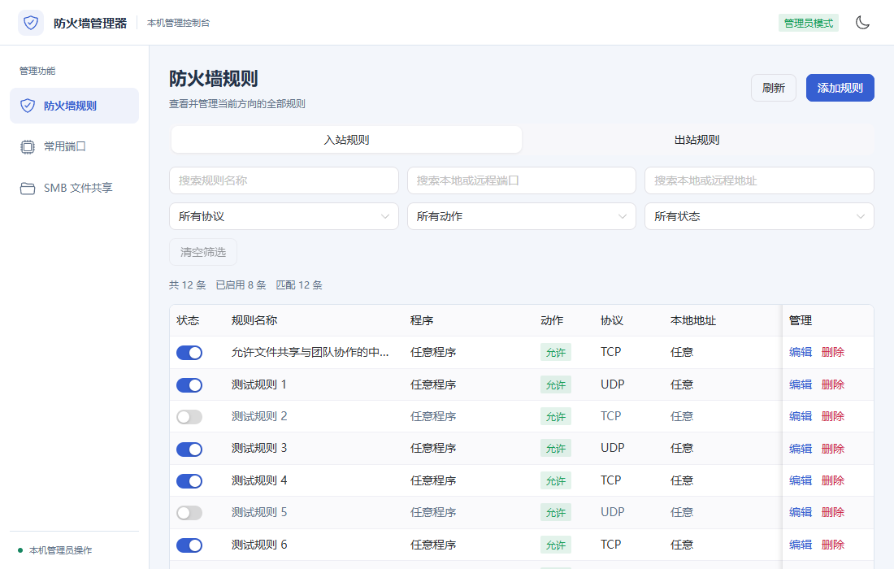
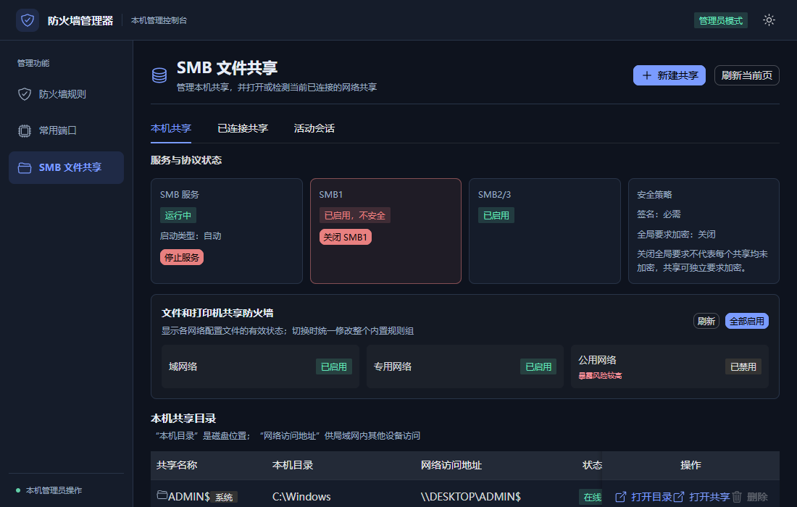

# 防火墙管理器 / Firewall Manager

<p align="center"></p>

基于 Wails v2 的 Windows 管理桌面应用，提供防火墙规则、常用端口和 SMB 文件共享三个模块。界面为中文，支持明暗主题。

[中文](#中文) | [English](#english) | [下载 / Downloads](https://github.com/whyy1/firewall-manager/releases)

## 中文

### 防火墙规则

- 查看全部入站或出站规则，每页显示 50 条；名称、端口、地址搜索及协议、动作、状态筛选作用于完整数据。
- 添加规则，编辑、删除或启停所选本地规则；规则名称在编辑时保持只读。
- 允许显示名称重复。以 Windows 内部 ID 和策略来源识别规则，显示可复制的身份信息；写入前重新核对来源、原名称、方向及唯一持久对象。
- 仅已确认的 `Local / PersistentStore` 来源且参数受支持的唯一规则可修改。组策略、动态、未知来源及身份歧义规则只读；其他未经确认的本地来源也保守只读。
- 更新只提交发生变化的字段，保留未编辑的服务、规则组、安全属性及 ICMP 限制。支持多配置文件、IP、子网、地址范围和列表校验。
- 支持程序文件选择、打开程序所在目录、拖动列宽、表格横向滚动与固定操作列。

### 常用端口

- 分别显示服务状态、检测到的端口和默认端口；未检测到时不会用默认值代替检测结果。
- 仅支持修改 RDP 和已有 WinRM HTTP 监听器的端口。修改会写入配置并重启相关服务，可能中断当前连接；不会自动添加对应防火墙规则。
- Windows SMB TCP 445 仅查看，不提供端口修改；其他未支持的服务同样仅查看。不会自动清理旧版本可能写入的 `SmbPort` 注册表值。
- 端口检测使用进程及监听信息推断，结果仅供参考，不能替代真实配置、监听及客户端连接验证。修改失败明确区分配置写入失败和写入后的服务恢复失败。

### SMB 文件共享

- 查看 SMB 服务、SMB1、SMB2/3、签名和全局加密状态；启动或停止本机 SMB 服务。服务停止或协议读取失败时，仍保留可用的服务恢复入口。
- 创建只读、更改或完全控制共享，默认只读；删除普通共享，保护系统特殊共享。
- 创建权限授予 Everyone 主体，仅设置共享权限，不修改 NTFS ACL；实际访问同时受共享权限和 NTFS 权限限制。
- 创建目录只接受有效的本机盘符绝对目录，拒绝 UNC、设备路径和映射网络盘。可用资源管理器打开本机目录或合法 UNC 共享。
- 查看活动会话并断开所选连接；关闭 SMB1，不提供启用入口。
- 查看文件和打印机共享防火墙组的配置文件状态；启停操作作用于整个规则组。
- 检测本机已连接或映射的网络共享，不主动扫描未连接设备。空结果不代表局域网没有共享。

### 权限与操作反馈

Windows 构建要求管理员权限，启动时由 UAC 请求提权。各写接口也执行权限检查。停止服务、删除共享、关闭 SMB1、断开会话及共享防火墙组切换均显示目标和影响并要求确认。

执行期间阻止重复提交；失败保留表单。写入成功但刷新失败会单独提示，并暂停依赖过期数据的修改，需检查当前系统状态后刷新。资源管理器打开成功反馈表示请求已提交，实际窗口和网络访问结果由 Windows 决定。

### 界面截图

以下截图来自模拟 Wails API 的界面测试，数据为测试样例。

| 模块 | 浅色 | 深色 |
|---|---|---|
| 防火墙规则 | [查看](docs/screenshots/rules-light.png) | [查看](docs/screenshots/rules-dark.png) |
| 常用端口 | [查看](docs/screenshots/ports-light.png) | [查看](docs/screenshots/ports-dark.png) |
| SMB 文件共享 | [查看](docs/screenshots/smb-light.png) | [查看](docs/screenshots/smb-dark.png) |





### 开发与构建

需要 Windows、Go 1.23+、Node.js 18+、Wails CLI v2.12 和 WebView2 Runtime。浏览器界面测试使用已安装的 Google Chrome。

```powershell
go install github.com/wailsapp/wails/v2/cmd/wails@v2.12.0
git clone https://github.com/whyy1/firewall-manager.git
cd firewall-manager
npm --prefix frontend install
wails dev
```

生产构建：

```powershell
wails build
Get-FileHash build/bin/firewall-manager.exe -Algorithm SHA256
```

最新可执行文件位于 `build/bin/firewall-manager.exe`。构建物、依赖目录及临时测试报告不提交到 Git。导出 Go API 变化后使用 `wails generate module` 重新生成绑定，不手工编辑 `frontend/wailsjs/`。

### 验证

从项目根目录运行；以下测试使用模拟执行器或模拟 Wails API，系统集成测试显式关闭。

```powershell
$env:FWM_SMB_INTEGRATION = '0'
$env:FWM_SMB_NETWORK_INTEGRATION = '0'
go test ./...
go vet ./...
npm --prefix frontend run test
npm --prefix frontend run test:ui
npm --prefix frontend run build
```

浏览器测试覆盖三种窗口尺寸、明暗主题、键盘操作、失败保留、权限限制与重复提交保护。它不能替代 Windows 管理员实机操作验收。验收结果见 [验收报告](docs/smb-management-acceptance.md)，实机影响和恢复方式见 [管理员验收清单](docs/v0.4.0-manual-acceptance.md)。

## English

Firewall Manager is a Windows desktop application built with Wails v2. Its Chinese interface provides firewall rules, common service ports, and SMB file sharing, with light and dark themes.

### Firewall rules

- Read all inbound or outbound rules, paginate by 50, and search or filter the full dataset by name, port, address, protocol, action, and status.
- Add rules and edit, delete, enable, or disable a selected local rule. Display names remain read-only during editing.
- Duplicate display names are allowed. Internal Windows IDs and policy provenance identify each rule; the source, original name, direction, and unique persistent object are checked again before writing.
- Only unique rules with confirmed `Local / PersistentStore` provenance and supported parameters are editable. Group Policy, dynamic, unknown, ambiguous, and other unconfirmed local sources remain read-only.
- Updates submit changed fields only, preserving untouched service, group, security, and ICMP properties. The editor validates profiles, IP addresses, subnets, ranges, and lists.
- Select program files, open their containing folders, resize columns, and use horizontal scrolling with fixed action columns.

### Common service ports

- Service status, detected ports, and defaults are shown separately. A default never substitutes for an undetected port.
- Port changes support RDP and an existing WinRM HTTP listener only. They write configuration and restart the service, may interrupt connections, and do not automatically create firewall rules.
- Windows SMB TCP 445 and unsupported services are read-only. The application does not remove a `SmbPort` registry value that an older version may have written.
- Detection infers ports from process and listener information. It does not prove the effective configuration or a working client connection. Errors distinguish configuration failure from a service restart failure after configuration was written.

### SMB file sharing

- Inspect service, SMB1, SMB2/3, signing, and global encryption status; start or stop the local SMB service. Unavailable protocol data does not hide an available service recovery action.
- Create read-only, change, or full-control shares, defaulting to read-only; remove ordinary shares while protecting special system shares.
- Share permissions apply to Everyone and do not change NTFS ACLs. Effective access is constrained by both share and NTFS permissions.
- Share creation requires a valid local drive-qualified directory and rejects UNC, device paths, and mapped network drives. Open local folders or valid UNC shares in Explorer.
- Inspect and disconnect a selected session; disable SMB1 without providing an enable action.
- Inspect profile status for the File and Printer Sharing firewall group. Toggling changes the entire group.
- Enumerate shares already connected or mapped on this machine, without scanning unconnected devices. An empty result does not imply that the network has no shares.

### Permissions and feedback

The Windows build requests Administrator elevation through UAC, and write APIs enforce privilege checks. Disruptive SMB actions require confirmation that includes their target and impact.

Operations prevent duplicate submission and retain failed forms. A successful write followed by a failed refresh is reported separately, and stale data blocks further dependent changes until refreshed. Explorer feedback confirms that an open request was submitted; Windows determines the visible window and network access result.

### Screenshots

Screenshots use mock Wails APIs and sample data. See the [light/dark screenshot table](#界面截图) above.

### Development and validation

Requirements: Windows, Go 1.23+, Node.js 18+, Wails CLI v2.12, and WebView2 Runtime. Mock interface tests use an installed Google Chrome browser.

Use the build and validation commands in the Chinese section above. `wails build` produces `build/bin/firewall-manager.exe`; regenerate exported API bindings with `wails generate module`. Do not commit binaries, dependency directories, or temporary test output.

Automated tests isolate Windows management commands and mock Wails APIs. Keep the two SMB integration switches disabled for routine testing. Mock tests cover three window sizes, both themes, keyboard controls, failure recovery, permissions, and duplicate submissions; real Administrator acceptance remains a separate step. See the [acceptance report](docs/smb-management-acceptance.md) and [manual checklist](docs/v0.4.0-manual-acceptance.md).

## 技术栈 / Technology

| Layer | Technology |
|---|---|
| Desktop | Wails v2.12 |
| Backend | Go, Windows APIs, PowerShell NetSecurity/SMB cmdlets, netsh |
| Frontend | Vue 3, Vite, Naive UI, Ionicons 5 |
| Tests | Go tests, Node test runner, Playwright with mock Wails APIs |

## License

MIT